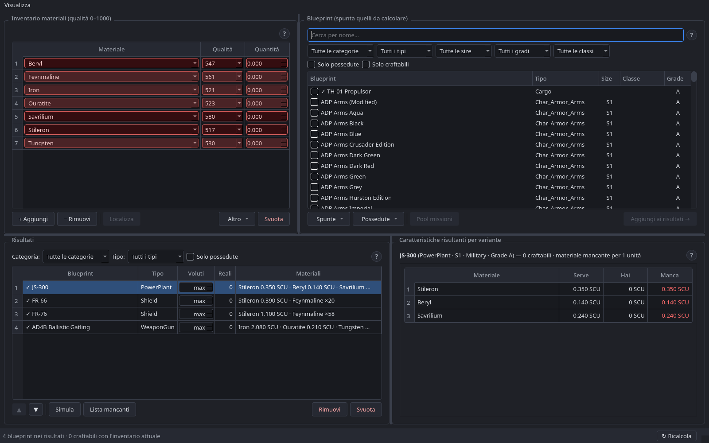

<div align="center">

# SC Blueprint Fabrication

**Il calcolatore di crafting per Star Citizen**: organizza i materiali che possiedi e scopri
cosa puoi craftare dalle tue blueprint, quante unità e con quali caratteristiche finali.

[](https://github.com/rastlien78/SC-BlueprintFabrication/releases/latest)
[](https://github.com/rastlien78/SC-BlueprintFabrication/releases)


[**⬇ Scarica**](#-download) · [Funzionalità](#-funzionalità) · [Installazione](#-installazione) · [Domande frequenti](#-domande-frequenti) · [Novità](CHANGELOG.md)

</div>

<p align="center"></p>

---

## ⬇ Download

| Sistema | File | |
|---|---|---|
| **Windows** 10/11 (64 bit) | `SC-BlueprintFabrication-Windows-x64.exe` | [**Scarica**](https://github.com/rastlien78/SC-BlueprintFabrication/releases/latest/download/SC-BlueprintFabrication-Windows-x64.exe) |
| **Linux** x86_64 | `SC-BlueprintFabrication-Linux-x86_64.tar.gz` | [**Scarica**](https://github.com/rastlien78/SC-BlueprintFabrication/releases/latest/download/SC-BlueprintFabrication-Linux-x86_64.tar.gz) |

Tutte le versioni, con le note di rilascio, sono nella pagina
[**Releases**](https://github.com/rastlien78/SC-BlueprintFabrication/releases).
Ogni release include `SHA256SUMS.txt` per verificare l'integrità dei file.

> **Nessuna installazione necessaria**: è un singolo file da avviare. I dati di gioco vengono
> scaricati automaticamente al primo avvio e tenuti aggiornati a ogni patch.

---

## ✨ Funzionalità

### 📦 Inventario materiali
- Inserisci i materiali che possiedi con **qualità** e **quantità**; puoi avere più scorte dello
  stesso materiale a qualità diverse.
- La qualità si sceglie solo tra i **livelli realmente estraibili in gioco** per quel minerale.
- I materiali mancanti per le blueprint scelte vengono aggiunti e **evidenziati in rosso**.

### 📍 Dove minare
- Il tasto **Localizza** mostra **dove** si trova un materiale (Stanton, Pyro, Nyx), in quale
  roccia e **con che resa**, con fasce colorate dal più ricco al più scarso e filtri per
  sistema e qualità.

### 📘 Blueprint
- Oltre **1600 blueprint craftabili**: componenti nave, laser e moduli minerari, armi
  personali, armature, vestiti, contenitori e altro.
- Ricerca per nome e **filtri multi-selezione** per categoria, tipo, size, grade e classe.
- Badge **«craftabile ora»** calcolato sul tuo inventario e filtro **«Solo craftabili»**.
- **Import automatico** delle blueprint che possiedi direttamente dai `Game.log` di Star
  Citizen, e filtro **«Solo possedute»**.
- **Pool missioni**: da quali ricompense di missione si ottiene una blueprint.

### 🛠 Risultati e crafting
- Per ogni blueprint scegli quante unità vuoi (**Voluti**) e vedi quante ne ottieni davvero
  (**Reali**), tenendo conto dei **materiali condivisi** tra più moduli.
- **Priorità** di consumo regolabile: i moduli in alto prendono per primi i materiali migliori.
- **Lista mancanti**: il totale di cosa ti manca per tutti i moduli, con collegamento a «dove minare».
- **Simula**: slider di qualità per vedere dal vivo come cambiano le caratteristiche.

### 📊 Caratteristiche finali
- Per ogni variante craftabile, il **valore base**, il **risultato finale** e il contributo di
  ogni materiale, calcolati in base alla qualità (scala 0–1000).
- Tasto **Craft** per scalare dall'inventario i materiali consumati.

### 💾 Comodità
- Salvataggio automatico di inventario e risultati alla chiusura.
- Esportazione CSV, guida rapida **«?»** in ogni pannello, tema scuro.
- **Aggiornamento automatico dei dati di gioco** all'avvio: vengono scaricati solo i file cambiati.

---

## 🚀 Installazione

### Windows
1. Scarica `SC-BlueprintFabrication-Windows-x64.exe` e mettilo in una **cartella tua**
   (es. `Documenti\SC-BlueprintFabrication\`).
2. Avvialo con un doppio click.
3. Se compare **«Windows ha protetto il PC»** (SmartScreen): clicca **Ulteriori informazioni →
   Esegui comunque**. L'avviso appare perché l'eseguibile non ha una firma digitale a pagamento.

### Linux
```bash
mkdir -p ~/Applicazioni/SC-BlueprintFabrication && cd ~/Applicazioni/SC-BlueprintFabrication
tar -xzf ~/Scaricati/SC-BlueprintFabrication-Linux-x86_64.tar.gz
./SC-BlueprintFabrication
```

> **Distribuzioni supportate**: qualsiasi distribuzione x86_64 con glibc 2.35 o superiore,
> per esempio Ubuntu 22.04+, Linux Mint 21+, Debian 12+, Fedora, Arch/CachyOS e SteamOS.

### Dove vengono salvati i dati
Accanto all'eseguibile l'app crea:
- `raw_data/` — i dati di gioco scaricati al primo avvio (serve internet solo quella volta);
- `user_session.json` — il tuo inventario e le tue blueprint.

Per questo va messa in una cartella **scrivibile** (non in `C:\Program Files`). Se sposti
l'eseguibile, sposta anche questi due elementi.

### Aggiornare
Scarica la nuova versione e **sostituisci solo l'eseguibile**: `raw_data/` e
`user_session.json` restano, con tutti i tuoi dati.

---

## ❓ Domande frequenti

<details>
<summary><b>L'antivirus segnala il file: è pericoloso?</b></summary>

No. Gli eseguibili creati con PyInstaller a volte vengono segnalati per errore («falso
positivo») perché si scompattano in una cartella temporanea all'avvio. Puoi verificare che il
file sia quello originale confrontando il suo SHA-256 con `SHA256SUMS.txt` della release.
</details>

<details>
<summary><b>I dati sono aggiornati all'ultima patch?</b></summary>

I dati provengono da [StarCitizenWiki/scunpacked-data](https://github.com/StarCitizenWiki/scunpacked-data),
estratti dai file di gioco a ogni patch. L'app controlla all'avvio e scarica solo ciò che è
cambiato. Con **Salta** (o senza connessione) parte coi dati già presenti.
</details>

<details>
<summary><b>Non trova il mio Game.log</b></summary>

Su Windows cerca nei dischi fissi; su Linux nei prefissi Wine, Lutris, Steam/Proton e nei
dischi montati. Se non lo trova, puoi selezionare il file a mano.
</details>

<details>
<summary><b>Ho trovato un bug / ho un'idea</b></summary>

Apri una segnalazione nella sezione [**Issues**](https://github.com/rastlien78/SC-BlueprintFabrication/issues).
</details>

---

## 📄 Crediti e licenze

- **Autore**: Rasty78. SC Blueprint Fabrication è gratuito; il codice sorgente non è pubblico.
- **Dati di gioco**: [StarCitizenWiki/scunpacked-data](https://github.com/StarCitizenWiki/scunpacked-data).
- **Componenti di terze parti**: l'interfaccia usa Qt for Python (PySide6), con licenza
  **LGPL v3**. Dettagli in [THIRD_PARTY_NOTICES.md](THIRD_PARTY_NOTICES.md).

*SC Blueprint Fabrication è un progetto amatoriale della community, non affiliato né approvato
da Cloud Imperium Games. Star Citizen® è un marchio registrato di Cloud Imperium Rights LLC.*
